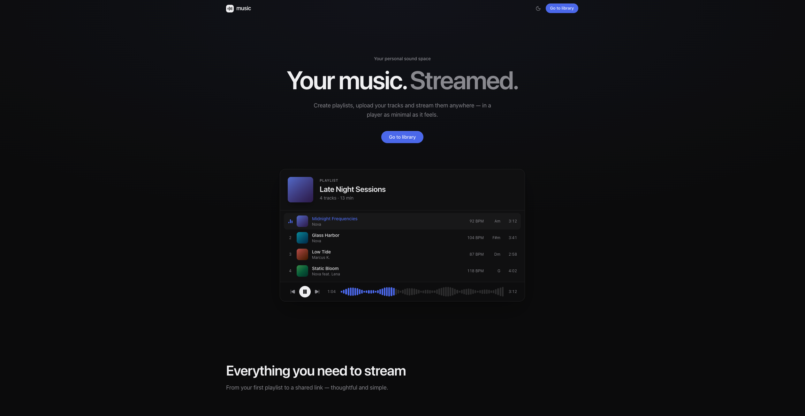

# music-backend

Preview: [music.marcey.net](https://music.marcey.net/)

Dieses Projekt ist die eine Hälfte des music-Projekts (die andere ist [music-frontend](https://github.com/Marc3y/music-frontend)). Die Inspiration liegt hierbei bei dem Projekt untitled. Auf der Seite kann man Songs, Beats und Projekte hochladen und in verschiedenen Playlists kategorisieren, sowie bestimmte Songs, Projekte oder auch Playlists mit anderen Personen teilen. Ebenfalls ist es möglich, Personen als Collaborator bestimmter Playlists hinzuzufügen.

Dieses Repository ist die Express/MongoDB-API, die [music-frontend](https://github.com/Marc3y/music-frontend) und die native iOS/macOS-App ([music-app](https://github.com/Marc3y/music-app)) bedient.

## Tech-Stack

- **Node.js / Express** mit TypeScript
- **MongoDB** als Datenbank
- S3 Objektspeicher (self-hosted MinIO) für Audiodateien, Projektdateien und Cover, Zugriff über AWS SDK v3
- `jsonwebtoken` + `bcrypt` für Authentication (Access-/Refresh-Token als httpOnly-Cookies)
- `zod` zur für eingehende Requests
- `music-metadata` zum Auslesen von ID3-Tags bei Upload
- `resend` für E-Mails (Verifizierung, Passwort-Reset)
- `express-rate-limit` für Rate-Limiting auf den Routen Login, Registrierung & Passwort-Flows
- Supabase für Google Login

## Features / API-Bereiche

### Auth & Konto (`/auth`, `/account`)

- Registrierung mit E-Mail Verifizierung, Login, Logout
- Google-Login über Supabase
- Passwort vergessen/zurücksetzen per E-Mail
- Access-/Refresh-Token über httpOnly-Cookies, wird automatisch erneuert
- Profil: username ändern, Profilbild hochladen und löschen
- Passwort ändern (Code anfordern dann bestätigen)
- Konto löschen (Code anfordern und bestätigen)
- Speicherverbrauch, Nutzungsübersicht und Statistiken (Top-Tracks, Top-Hörer) pro Konto

### Playlists (`/playlists`)

- Erstellen, Umbenennen, Löschen, Cover-Upload
- Eigene Sortierung (Drag & Drop, serverseitig gespeichert)
- Collaborator hinzufügen/entfernen, Annehmen über Link (`/playlists/join/:token`)
- Öffentliches Teilen: aktivieren/deaktivieren, Passwortschutz, Download erlauben/nicht erlauben, Einschränkung auf bestimmte Benutzernamen
- Öffentliche, nicht authentifizierte Endpunkte zum Abspielen/Herunterladen geteilter Playlists mit Hörzähler

### Audiodateien (`/audio-files`)

- Upload über presigned S3-URLs, aufgeteilt für Audiodateien und Projektarchive (`.zip`/`.rar`)
- Mehrere Versionen pro Track, Auswahl der aktiven Hauptversion, BPM-/Key-Metadata
- Pro Version optional eine eigene Projektdatei (eigener Upload-/Download-/Lösch-Flow)
- Automatisches Auslesen von Metadaten (Titel, Künstler) beim Upload
- Endpunkt für Hörzähler (zählt einmal pro Wiedergabe nach Mindestdauer von 15s)
- Teilen von Tracks/Projektdateien mit Passwortschutz
- Sortierung innerhalb einer Playlist

### Benachrichtigungen (`/notifications`)

- Stream über Server-Sent Events (`/notifications/stream`)
- Liste von allen Benachrichtigungen
- Automatisches Löschen alter Benachrichtigungen nach 60 Tagen

